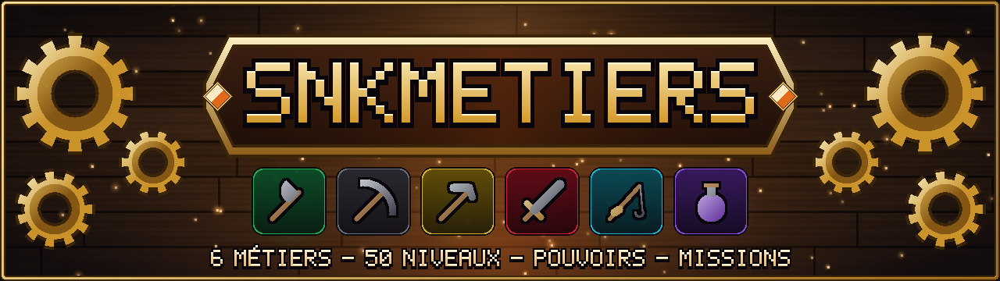
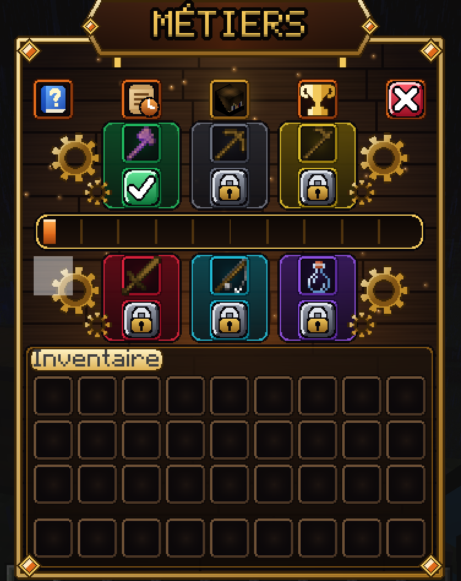

<b>6 métiers à faire monter, avec des pouvoirs, des missions chaque jour et de l'argent à gagner.</b> 
Plugin Minecraft pour serveurs <b>Paper 1.21.4 à 26.3</b>, par <b>SnkAlex</b>.

<a href="#-fonctions">Fonctions</a> •
<a href="#-les-métiers">Métiers</a> •
<a href="#-captures">Captures</a> •
<a href="#-commandes">Commandes</a> •
<a href="#-compatibilité">Compatibilité</a> •
<a href="#-lobtenir">L'obtenir</a>

---

## ✨ Fonctions

### 📈 Des métiers qui évoluent
- **50 niveaux** par métier : chaque action rapporte de l'XP et de l'argent
- **6 paliers** : Bois, Pierre, Fer, Or, Diamant et Netherite. L'icône du métier change à chaque palier
- Un **niveau général** qui débloque jusqu'à 6 métiers en même temps
- On peut changer de métier sans perdre sa progression

### ⚡ Des pouvoirs à chaque palier
Plus de vitesse, d'XP et d'argent, puis un vrai pouvoir au Diamant et au Netherite : abattre un arbre entier, miner en 3 × 3, faucher en 5 × 5...

### 📜 Missions et classement
- **3 missions par jour et par métier**, tirées au sort pour chaque joueur
- **Classement** des meilleurs joueurs
- Une page par métier : ce qui rapporte, les paliers, les statistiques

### 💰 L'argent
- Monnaie intégrée avec `/money` et `/pay`, ou celle de ton plugin d'économie grâce à Vault
- Les autres plugins compatibles Vault peuvent utiliser la monnaie intégrée

### 🛡️ Contre la triche
Les blocs posés par les joueurs (même déplacés avec un piston), les générateurs de pierre et les monstres de spawner ne rapportent rien.

### 🎨 Des menus dessinés
Les menus ont leur propre interface grâce à un pack de ressources fourni. Les joueurs qui n'ont pas le pack voient des menus classiques.

---

## 👷 Les métiers

| Métier | 💎 Pouvoir Diamant (niveau 35) | 🔥 Pouvoir Netherite (niveau 50) |
|---|---|---|
| 🪓 **Bûcheron** | Abat l'arbre entier | Replante une pousse |
| ⛏️ **Mineur** | Mine en 3 × 3 | Mine en 3 × 3 × 2 |
| 🌾 **Fermier** | Fauche en 3 × 3 | Fauche en 5 × 5 et replante |
| ⚔️ **Chasseur** | Dégâts × 1,3 à l'épée | Enflamme à chaque coup |
| 🎣 **Pêcheur** | 25 % de prise double | 50 % de prise double |
| ⚗️ **Alchimiste** | 25 % d'ingrédient rendu | 50 % d'ingrédient rendu |

Avant ça, pour tous : **vitesse + 30 %** (Pierre, niveau 5), **XP × 1,5** (Fer, niveau 10) et **argent × 1,5** (Or, niveau 20).

Chaque métier a son fichier : on change ce qui rapporte, l'XP, l'argent, les missions, le nom, la couleur et les icônes.

---

## 📸 Captures

 Le menu <code>/jobs</code> : les 6 métiers et le niveau général

---

## ⌨️ Commandes

| Commande | Effet |
|---|---|
| `/jobs` (ou `/metiers`) | Menu des métiers |
| `/money [joueur]` | Affiche l'argent |
| `/pay <joueur> <montant>` | Donne de l'argent |
| `/jobsadmin reload` | Recharge les réglages (admin) |
| `/jobsadmin niveau <joueur> <métier> <n>` | Règle le niveau d'un métier (admin) |
| `/jobsadmin general <joueur> <n>` | Règle le niveau général (admin) |
| `/jobsadmin argent <donner\|retirer\|definir> <joueur> <montant>` | Gère l'argent (admin) |

**Permission :** `metiers.admin`.

---

## 🧩 Compatibilité

| | |
|---|---|
| **Versions** | 1.21.4 à 26.3, un seul fichier pour toutes |
| **Testé sur** | Paper 1.21.4, 1.21.11, 26.2 et 26.3 |
| **Serveur** | Paper |
| **Java** | 21 ou plus (celui de ta version de Paper) |
| **Facultatif** | Vault, pour partager l'argent avec les autres plugins |

**Va plus loin avec les autres plugins Snk** (facultatifs) :
- **[SnkQuetes](https://github.com/SnkStudio/SnkQuetes)** : des défis et des quêtes qui donnent de l'XP de métier
- **[SnkPNJ](https://github.com/SnkStudio/SnkPNJ)** : un maître des métiers à qui parler
- **[SnkInterface](https://github.com/SnkStudio/SnkInterface)** : le niveau de métiers dans le tableau et les classements
- **[SnkCosmetiques](https://github.com/SnkStudio/SnkCosmetiques)** : des cosmétiques 3D à acheter avec l'argent des métiers
- **[SnkPass](https://github.com/SnkStudio/SnkPass)** : un pass de saison avec des missions et de l'XP de métier
- **[SnkBoutiques](https://github.com/SnkStudio/SnkBoutiques)** : boutiques-coffres des joueurs dans le territoire de leur clan
- **[SnkMarche](https://github.com/SnkStudio/SnkMarche)** : boutique et hôtel des ventes, avec plus d'annonces selon le niveau
- **[SnkClans](https://github.com/SnkStudio/SnkClans)** : l'XP de métier des membres fait monter le clan
- **[SnkGemmes](https://github.com/SnkStudio/SnkGemmes)** : 21 outils en émeraude, rubis et saphir

---

## 📦 Ce que tu reçois
- Le plugin (`.jar`)
- Le pack de ressources des menus
- Le guide d'installation et le guide complet, en français

Aucune connaissance en code n'est nécessaire : tout se règle dans des fichiers expliqués ligne par ligne.

---

## 📩 L'obtenir

Le plugin n'est pas en téléchargement libre. Pour le prix, une question ou une démonstration :

➡️ **[Écris-moi ici](../../issues/new/choose)** (il faut un compte GitHub, c'est gratuit)

> Les messages sont **publics** : n'écris ni adresse e-mail, ni mot de passe, ni information de paiement. On passe ensuite en privé.

---

© SnkAlex. Tous droits réservés. Voir <a href="LICENSE.md">la licence</a>. 
Ce plugin n'est pas un produit officiel Minecraft. Il n'est ni approuvé par Mojang ou Microsoft, ni associé à eux.

